# Compta Groupe Saint-Martin

Application mobile (PWA) pour que les chefs d'unité du **Groupe Saint-Martin** déclarent leurs dépenses en deux minutes, justificatif compris, et que les trésoriers les suivent, les remboursent et les exportent.

🔗 **En ligne : [comptagroupe.vercel.app](https://comptagroupe.vercel.app)** · front React sur Vercel, base, connexion et stockage sur Supabase.

<p align="center">
  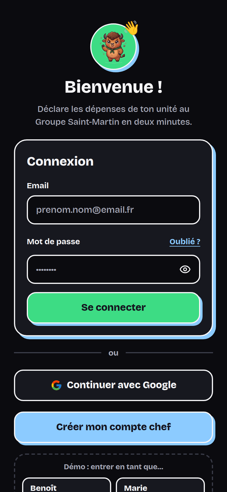
  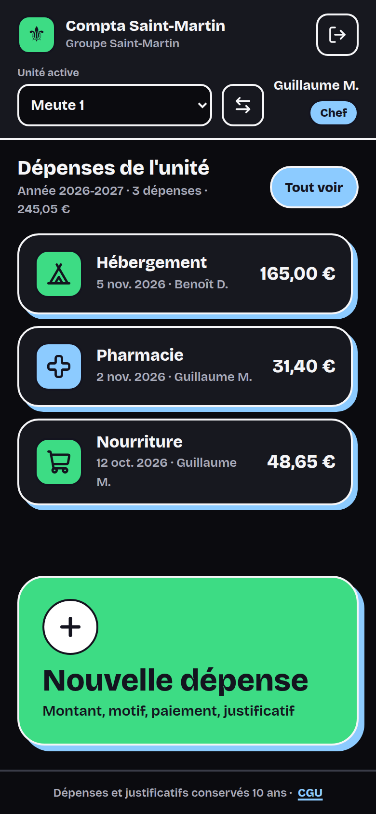
  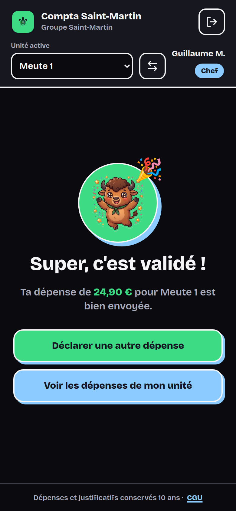
  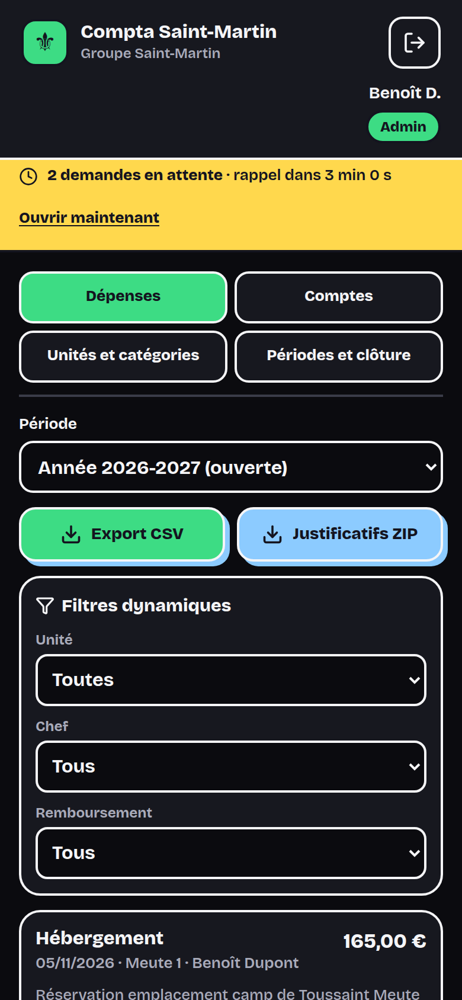
</p>

## Sommaire

1. [En bref](#1-en-bref)
2. [Parcours en images](#2-parcours-en-images)
3. [Comptes de test](#3-comptes-de-test)
4. [Fonctionnalités](#4-fonctionnalités)
5. [Base de données et sécurité](#5-base-de-données-et-sécurité)
6. [Développer en local](#6-développer-en-local)
7. [Déploiement](#7-déploiement)
8. [Réglementation et RGPD](#8-réglementation-et-rgpd)
9. [Avant la mise en production](#9-avant-la-mise-en-production)

## 1. En bref

| Pour qui | Ce qu'il fait |
| :--- | :--- |
| **Chef d'unité** | Se connecte par email ou avec Google, déclare une dépense en 5 étapes (montant, motif, paiement, justificatif, récapitulatif), suit les dépenses de son unité et leur remboursement, demande à changer d'unité |
| **Admin** (chef de groupe, trésorier) | Valide les nouveaux comptes et les changements d'unité, consulte et filtre toutes les dépenses, marque les remboursements, exporte en CSV et en ZIP, gère unités, catégories et périodes |
| **Tout le monde** | Mode clair ou sombre selon le téléphone, installation sur l'écran d'accueil, écran « Pas de réseau » quand la connexion manque, Marty le bison comme mascotte |

Le design suit la maquette mobile du projet (contours épais, ombres décalées, police Bricolage Grotesque) et s'adapte au PC : colonne centrée côté chef, tableau complet côté admin.

## 2. Parcours en images

Captures prises sur l'appli en mode démo (données d'exemple), en mode sombre sauf mention contraire. Pour les refaire : voir [Développer en local](#6-développer-en-local).

### Connexion

| Connexion | Mode clair | Pas de réseau |
| :---: | :---: | :---: |
|  | 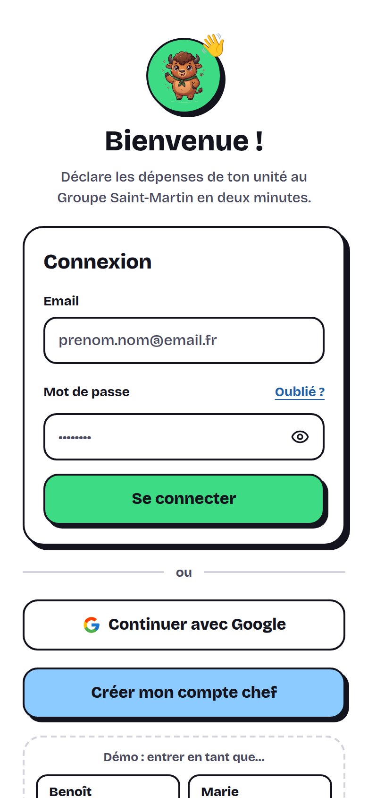 | 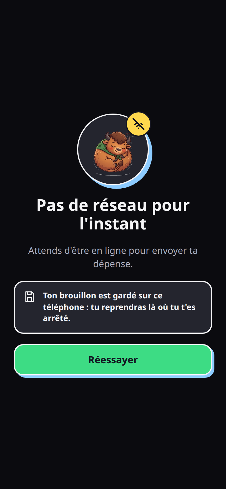 |
| Email et mot de passe, ou **Continuer avec Google** | Le thème suit celui du téléphone | Page autonome, même si l'appli n'a jamais chargé |

### Déclarer une dépense (chef)

| Accueil | Étape 2 : motif | Étape 3 : paiement |
| :---: | :---: | :---: |
|  | 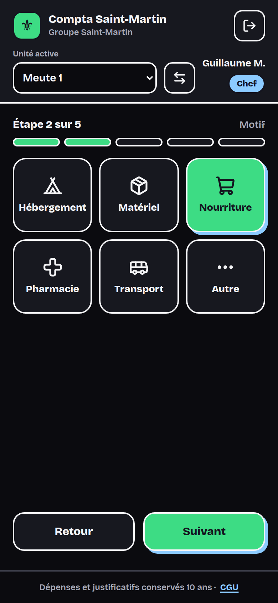 | 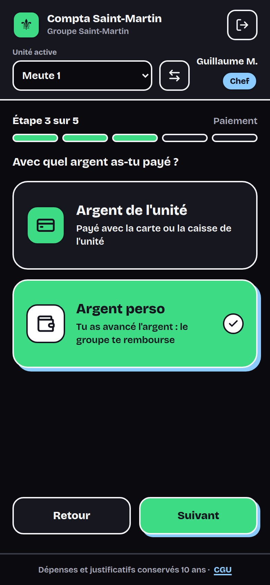 |
| Dernières dépenses de l'unité, gros bouton « Nouvelle dépense » | Catégories de la base, « Autre » avec précision | Argent de l'unité ou argent perso à rembourser |

| Étape 4 : justificatif | Étape 5 : récapitulatif | Dépense envoyée |
| :---: | :---: | :---: |
| 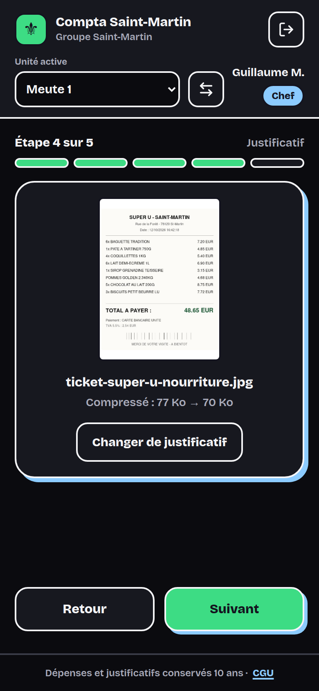 | 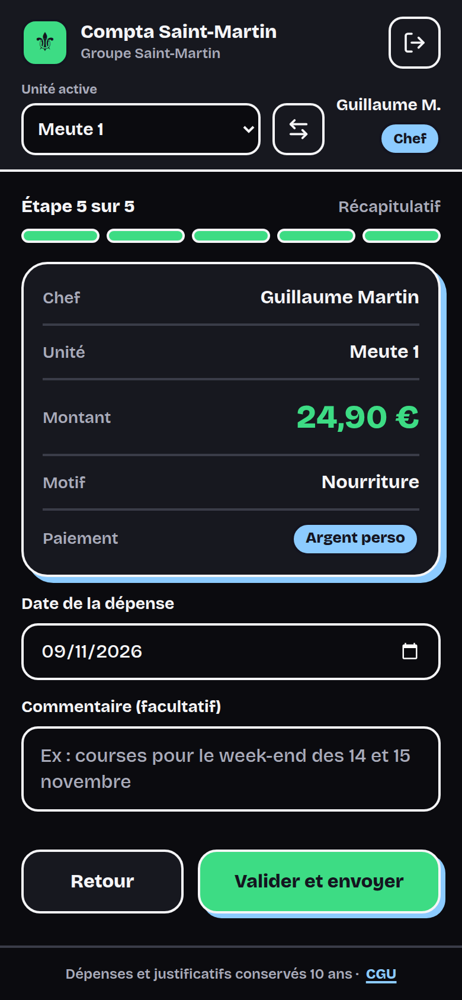 |  |
| Photo ou PDF obligatoire, compressé avant l'envoi | Date et commentaire modifiables | Retour vers une nouvelle dépense ou la liste |

### Suivre son unité (chef)

| Dépenses de l'unité | Demande de changement d'unité | Compte en attente |
| :---: | :---: | :---: |
| 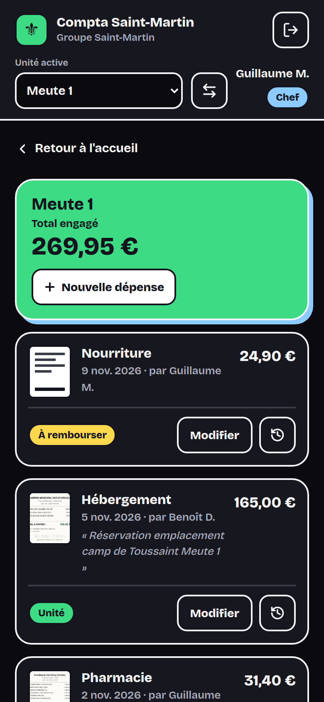 | 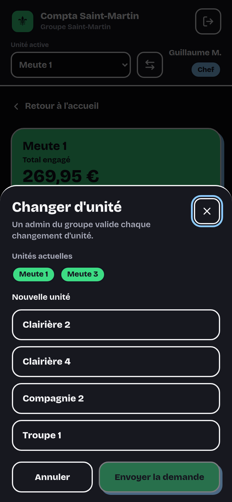 | 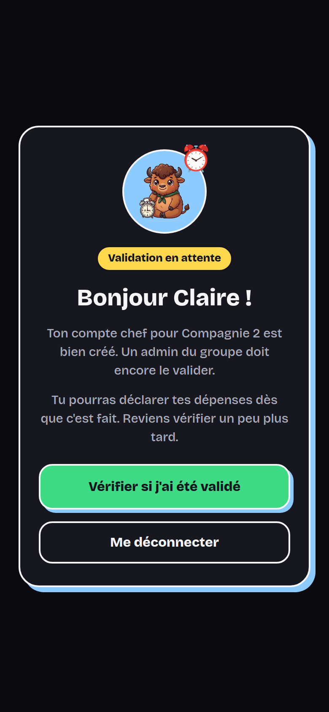 |
| Total engagé, statut de remboursement en lecture seule, historique | Validée ensuite par un admin | Tant qu'un admin n'a pas validé le compte |

### Administrer (admin)

| Comptes en attente | Dépenses sur téléphone |
| :---: | :---: |
| 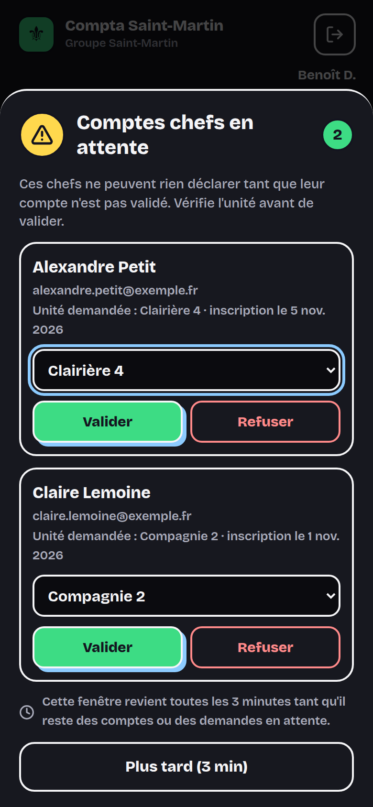 |  |
| Fenêtre imposée toutes les 3 minutes : nouveaux comptes, changements d'unité et remboursements | Filtres, cartes, export CSV et ZIP |

**Sur PC : tableau des dépenses**, sans défilement horizontal
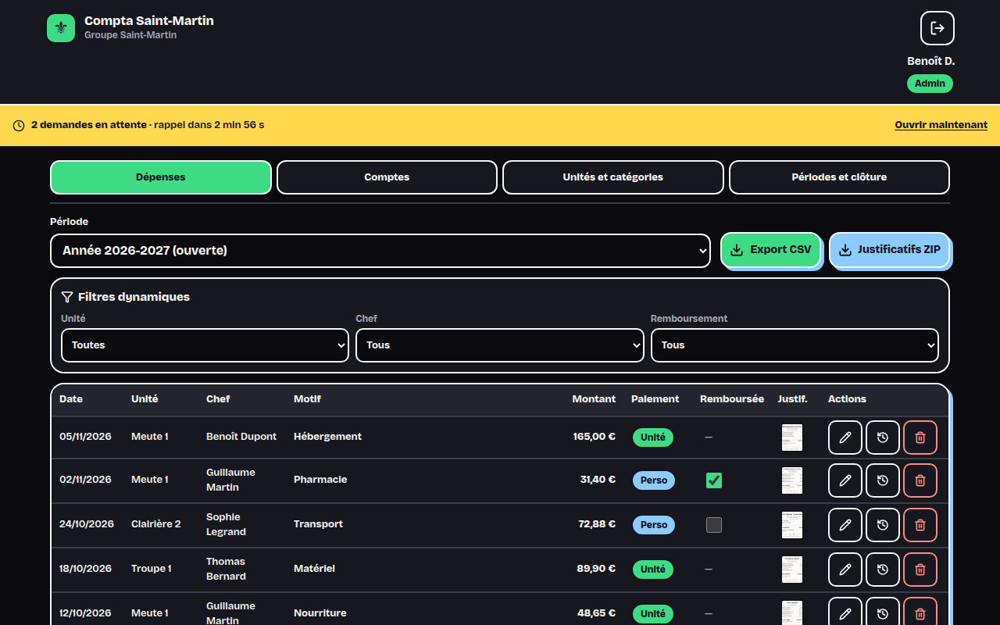

**Comptes et rôles**, avec l'email de chaque compte
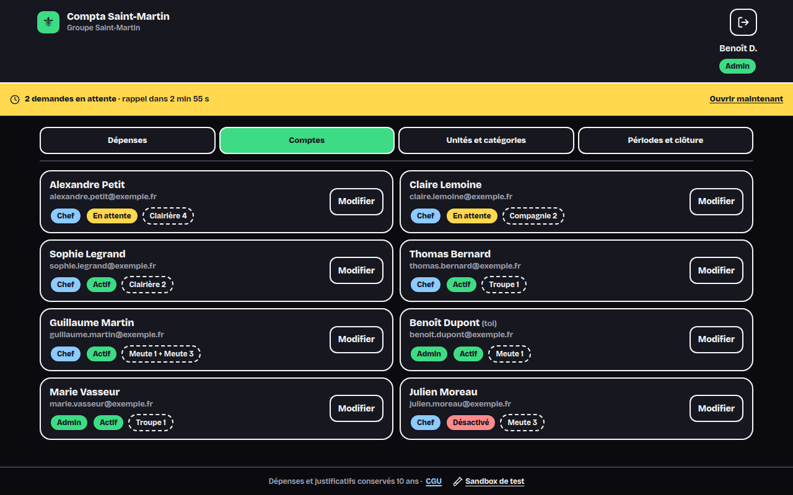

**Périodes et clôture**
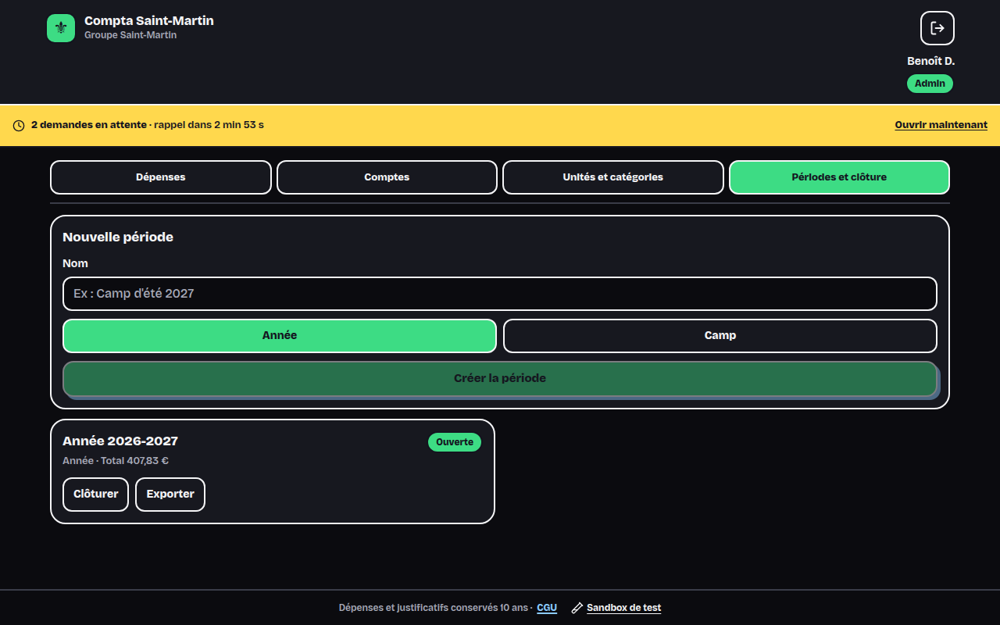

## 3. Comptes de test

> [!WARNING]
> Phase de test : ces comptes existent sur la base Supabase utilisée par [comptagroupe.vercel.app](https://comptagroupe.vercel.app). **À supprimer avant la mise en production** (voir [section 9](#9-avant-la-mise-en-production)).

| Rôle | Nom | Email | Mot de passe | Unité | Statut |
| :--- | :--- | :--- | :--- | :--- | :--- |
| Admin | Benoît Dupont | `ben.dupont@groupe-enf.fr` | `Password123!` | aucune (groupe) | actif |
| Admin | Benoît Dupont | `admin.dupont@groupe-enf.fr` | `Password123!` | Troupe 1 | actif |
| Admin | Marie Vasseur | `marie.admin@groupe-enf.fr` | `Password123!` | Meute 3 | actif |
| Chef | Alexandre Martin | `chef.martin@gmail.com` | `SuperSecretPassword123!` | Meute 1 | actif |
| Chef, 2 unités | Guillaume Martin | `chef.guillaume@groupe-enf.fr` | `Password123!` | Meute 1 et Meute 3 | actif |
| Chef | Claire Lemoine | `chef.claire@groupe-enf.fr` | `Password123!` | Compagnie 2 | en attente |
| Chef | Julien Faure | `chef.julien@groupe-enf.fr` | `Password123!` | Clairière 2 | désactivé |

Avec **Continuer avec Google**, n'importe quel compte Google peut aussi s'inscrire : il complète son nom et son unité, puis attend la validation d'un admin.

## 4. Fonctionnalités

### Chef d'unité

- **Connexion** par email et mot de passe, ou avec Google. Un mauvais mot de passe affiche « Identifiant ou mot de passe incorrect » sans vider l'email.
- **Inscription** avec vrai prénom et nom (pas de totem), unité et acceptation des CGU ; le compte reste en attente jusqu'à la validation d'un admin.
- **Nouvelle dépense en 5 étapes** :
  1. montant (virgule ou point, espaces acceptés, entre 0 et 10 000 €) ;
  2. motif parmi les catégories de la base, « Autre » avec précision obligatoire ;
  3. paiement : argent de l'unité, ou argent perso à rembourser ;
  4. justificatif photo ou PDF **obligatoire**, image compressée avant l'envoi ; sans envoi réussi, la dépense n'est pas enregistrée ;
  5. récapitulatif, date (dans la période, pas dans le futur) et commentaire de 300 caractères maximum.
- **Brouillon** gardé sur le téléphone en cas de coupure réseau.
- **Dépenses de l'unité** : total engagé, aperçu du justificatif, modification avec historique (qui, quand, avant, après). Une dépense remboursée ne se modifie plus ; le statut de remboursement est en lecture seule.
- **Deux unités** : sélecteur d'unité active dans l'en-tête ; **demande de changement d'unité** envoyée à l'admin.

### Admin

- **Fenêtre « Demandes en attente »**, imposée et rappelée toutes les 3 minutes tant qu'il reste des comptes à valider, des demandes de changement d'unité ou des **remboursements à faire** ; « Voir les remboursements » ouvre les dépenses filtrées sur « À rembourser ».
- **Remboursement définitif** : cocher « Remboursée » ouvre une confirmation ; une fois confirmée, la case reste verrouillée (aussi bloqué en base, migration `20261109000003`).
- **Email de remboursement** : confirmer le remboursement envoie au chef un email « [Comptabilité groupe] Remboursement de ta dépense du … » (SMTP Gmail, configuration dans **[docs/EMAILS.md](docs/EMAILS.md)**). Le message affiché dit si l'email est parti.
- **Dépenses** : filtres par unité, chef et remboursement ; case « Remboursée » pour l'argent perso ; modification, historique, suppression.
- **Exports** : CSV pour Excel (point-virgule, UTF-8 avec BOM, colonnes au choix, caractères de formule `= + - @` retirés en tête de champ) et ZIP des justificatifs renommés `AAAA-MM-JJ_Unite_MontantEUR.ext`.
- **Comptes** : email affiché, fiche avec unités, rôle et statut ; impossible de retirer le dernier admin actif.
- **Unités et catégories** activables et désactivables.
- **Périodes** (année ou camp) : clôture avec export automatique, réouverture, **purge** réservée aux périodes clôturées, avec avertissement avant 10 ans, sauvegarde CSV et ZIP vérifiée, suppression en base puis des fichiers.

### Pour tous

- PWA installable ; service worker qui garde l'appli et une page « Pas de réseau » autonome.
- Mode clair ou sombre automatique, cibles tactiles de 44 px, navigation au clavier, fenêtres accessibles (focus gardé, Échap).

## 5. Base de données et sécurité

- **Règles d'accès (RLS)** : un chef ne voit et ne modifie que les dépenses de ses unités, sur une période ouverte. Il ne peut ni changer son rôle, son statut, ses unités ou son email, ni marquer une dépense « Remboursée », ni créer de profil admin.
- **Justificatifs** dans un stockage privé, rangés par dossier d'unité (`<id de l'unité>/<fichier>`) et servis par liens signés d'une heure.
- **Migrations** : lancées à la main dans l'éditeur SQL de Supabase. Ordre, contrôles, rangement des justificatifs, retour arrière et journal : **[docs/MIGRATIONS.md](docs/MIGRATIONS.md)**.
- **Connexion Google** : configuration Google Cloud et Supabase pas à pas dans **[docs/CONNEXION-GOOGLE.md](docs/CONNEXION-GOOGLE.md)**.
- **Emails** : fonction serveur Vercel `api/notifier-remboursement.ts`, envoi SMTP ; réglages dans **[docs/EMAILS.md](docs/EMAILS.md)**.

## 6. Développer en local

Prérequis : Node 20 ou plus. Bun est lancé via `npx`, inutile de l'installer.

```bash
npm install
```

Sans fichier `.env.local`, l'appli démarre en **mode démo** : données d'exemple dans le navigateur, boutons « Démo : entrer en tant que… » sur l'écran de connexion, aucune connexion à Supabase.

```bash
npx vite --port 3300
```

Pour travailler sur la vraie base, créer `.env.local` à partir de [`.env.example`](.env.example) (`VITE_SUPABASE_URL`, `VITE_SUPABASE_ANON_KEY`).

Contrôles avant chaque push :

```bash
npx tsc --noEmit
```

```bash
npx --yes bun@1 test
```

```bash
npx vite build
```

Captures du README, prises en mode démo pendant que `npx vite --port 3300` tourne (Chrome ou Chromium requis) :

```bash
npx --yes bun@1 run scripts/capture-all-screenshots.ts
```

| Dossier | Contenu |
| :--- | :--- |
| `src/components/ui/` | Composants de base du design : boutons, pastilles, champs, fenêtres, bandeaux |
| `src/components/chef/`, `src/components/admin/` | Écrans chef et admin |
| `src/lib/` | Montants, exports CSV et ZIP, permissions, liens signés, client Supabase et mode démo |
| `supabase/migrations/` | Migrations SQL, dans l'ordre |
| `docs/` | Guides (migrations, Google) et captures |

## 7. Déploiement

Chaque push sur `main` est déployé par Vercel. Variables d'environnement du projet Vercel :

| Variable | Valeur |
| :--- | :--- |
| `VITE_SUPABASE_URL` | URL du projet Supabase |
| `VITE_SUPABASE_ANON_KEY` | clé publique (anon) de Supabase |
| `VITE_ENABLE_SANDBOX` | `false` |
| `VITE_ENABLE_GOOGLE_AUTH` | facultatif ; `false` masque le bouton Google |

Si un push n'apparaît pas dans **Vercel → Deployments**, le relancer avec **⋯ → Create Deployment → main → Deploy to Production**.

## 8. Réglementation et RGPD

- **Conservation de 10 ans** des pièces comptables (article L123-22 du Code de commerce) : la purge d'une période de moins de 10 ans affiche un avertissement.
- **Cloisonnement** par unité et justificatifs privés.
- **Mineurs** : aucune donnée nominative ou médicale d'enfant dans les commentaires.
- Les textes « Qui y a accès » et « Tes droits » des conditions d'utilisation sont **à rédiger** (`src/components/legal/LegalModal.tsx`).

## 9. Avant la mise en production

| À faire | Où |
| :--- | :--- |
| Supprimer les comptes de test et cette liste du README | Supabase → Authentication ; section 3 |
| Retirer l'admin automatique pour `ben.dupont@` et `admin.dupont@` | fonction `handle_new_user` (`supabase/migrations/20261109000002_connexion_google.sql`) |
| Retirer la règle d'insertion libre dans l'historique | `history_insert_policy` |
| Supprimer la page sandbox | `npm run clean:sandbox` |
| Supprimer les tables de sauvegarde du 09/11/2026 | `public.sauvegarde_20261109_*` |
| Rédiger les textes RGPD manquants | `src/components/legal/LegalModal.tsx` |
| Envoyer les emails depuis l'adresse du trésorier au lieu de celle de la meute | Vercel → `SMTP_USER`, `SMTP_PASSWORD` ([docs/EMAILS.md](docs/EMAILS.md)) |
