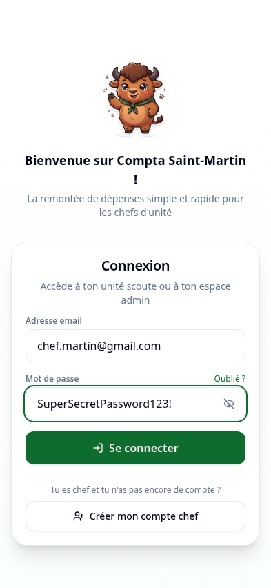
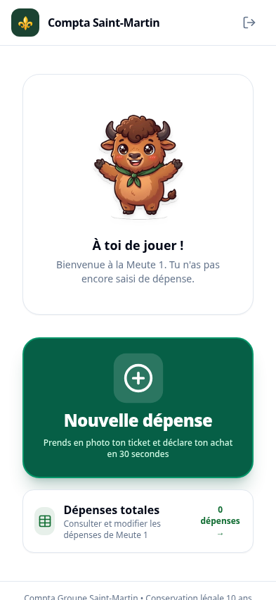
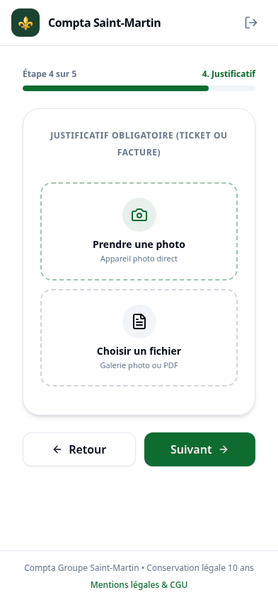
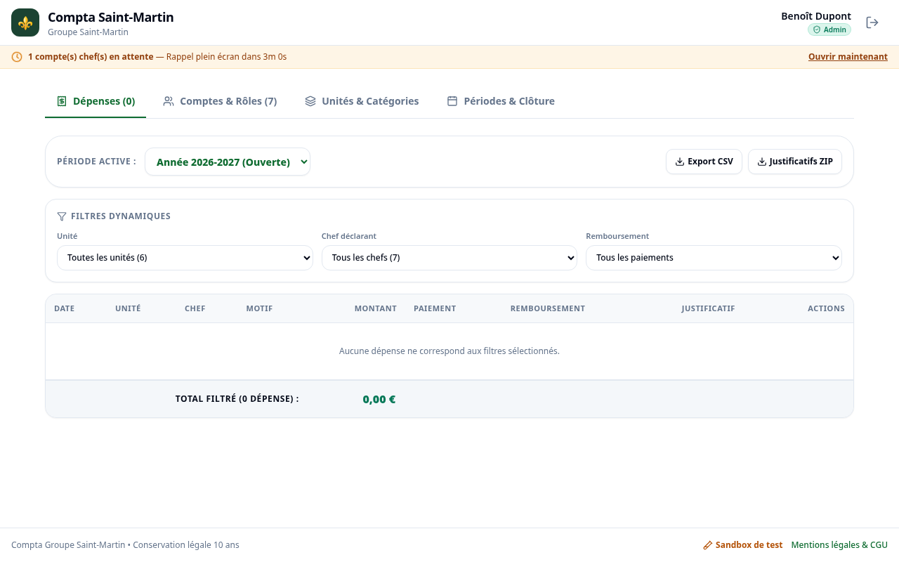
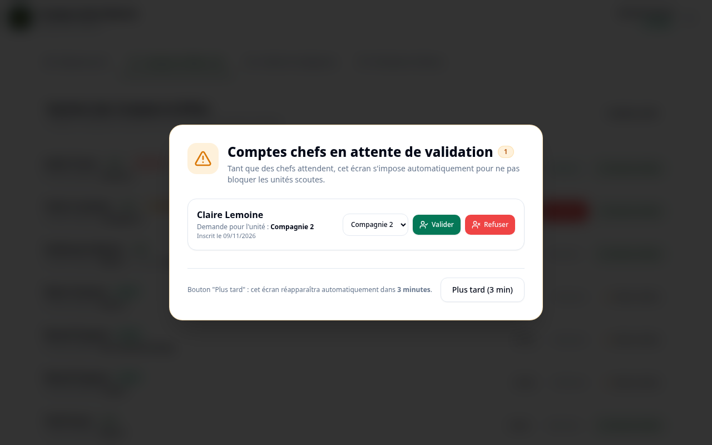

# ⚜️ Compta Groupe Saint-Martin - Remontée de Dépenses Scoutes

Application mobile-first **Progressive Web App (PWA)** de gestion, remontée et suivi des dépenses scoutes pour les chefs d'unité du **Groupe Saint-Martin**.

Développée selon une architecture **Zero-Backend (sans serveur Node.js)**, déployée en production sur **Vercel** et s'appuyant sur l'infrastructure **Supabase** (PostgreSQL avec Row Level Security, Authentification GoTrue et Storage privé sécurisé).

🔗 **Application en ligne : [https://comptagroupe.vercel.app](https://comptagroupe.vercel.app)**

---

## 🔑 1. Comptes de Test Réels (Supabase en Production)

> [!IMPORTANT]
> Tous les comptes ci-dessous sont **actifs et vérifiés** sur la base Supabase en production. Vous pouvez vous connecter immédiatement sur **[comptagroupe.vercel.app](https://comptagroupe.vercel.app)** pour tester chaque profil et parcours.

| Rôle | Nom & Prénom | Identifiant (Email) | Mot de passe | Unité de rattachement | Statut | Ce que vous pouvez tester |
| :--- | :--- | :--- | :--- | :--- | :--- | :--- |
| **Administrateur** | Benoît Dupont | `ben.dupont@groupe-enf.fr` | `Password123!` | *Aucune (Non rattaché - Groupe)* | **Actif** | Vue globale groupe, modification de l'unité des dépenses, bannières 3 min, exports CSV/ZIP, gestion des comptes |
| **Administrateur** | Benoît Dupont | `admin.dupont@groupe-enf.fr` | `Password123!` | Troupe 1 | **Actif** | Compte admin de secours rattaché à Troupe 1 |
| **Administratrice** | Marie Vasseur | `marie.admin@groupe-enf.fr` | `Password123!` | Meute 3 | **Actif** | Profil trésorière : validation des remboursements perso en 1 clic |
| **Chef d'Unité** | Alexandre Martin | `chef.martin@gmail.com` | `SuperSecretPassword123!` | Meute 1 | **Actif** | Déclaration de dépenses au pouce, consultation des totaux de l'unité, justificatifs |
| **Chef Multi-Unités** | Guillaume Martin | `chef.guillaume@groupe-enf.fr` | `Password123!` | Meute 1 & Meute 3 | **Actif** | **Sélecteur d'unité active** dans le header, bascule instantanée entre Meute 1 et Meute 3 |
| **Chef en Attente** | Claire Lemoine | `chef.claire@groupe-enf.fr` | `Password123!` | Compagnie 2 | **En attente** | Écran d'attente convivial avec Marty, compte à valider côté admin |
| **Chef Désactivé** | Julien Faure | `chef.julien@groupe-enf.fr` | `Password123!` | Clairière 2 | **Désactivé** | Écran d'accès suspendu sécurisé invitant à contacter le chef de groupe |

> [!TIP]
> **Aperçu du mot de passe** : Sur l'écran de connexion et d'inscription, cliquez sur l'icône **œil** (`Eye` / `EyeOff`) pour afficher ou masquer votre mot de passe en cours de frappe.

---

## 📸 2. Parcours Utilisateurs en Images

Les captures d'écran ci-dessous ont été générées automatiquement en conditions réelles avec **Chromium Headless** (`puppeteer-core`) :

### A. Parcours Chef d'Unité (Mobile-First)

| 1. Connexion avec aperçu mot de passe | 2. Accueil Chef & Totaux engagés | 3. Formulaire de saisie en 5 étapes |
| :---: | :---: | :---: |
|  |  |  |
| Mascotte Marty, champ email et œil de prévisualisation | Total de l'unité, liste collaborative et bouton rapide | Saisie rapide au pouce avec compression automatique des photos |

---

### B. Parcours Administrateur (Tableau de Bord & Rôles)

#### 4. Tableau de bord Administrateur (Dépenses, Filtres, Périodes)
Vue d'ensemble de toutes les unités, filtrage dynamique par unité / chef / statut de remboursement, modification de l'unité des dépenses, export Excel CSV et archive ZIP des justificatifs :


#### 5. Gestion des Utilisateurs & Rôles
Affectation d'unité facultative pour les administrateurs (*« Non rattaché (Groupe) »*), validation en 1 clic des chefs en attente, affectation d'une 2e unité et promotion admin avec garde-fou :


---

### C. États Spéciaux & Mode Hors-Ligne

| 6. Compte en Attente de Validation | 7. Mode Hors-Ligne Sécurisé |
| :---: | :---: |
|  |  |
| Message bienveillant invitant le chef à patienter | Blocage automatique de l'envoi sans perte de données, reprise dès retour du réseau |

---

## 🏕️ 3. Fonctionnalités Détaillées

### Côté Chef d'Unité
- **Prise en main immédiate** : Gros bouton tactile prioritaire *"Nouvelle dépense"*, consultation du total engagé de l'unité.
- **Formulaire guidé en 5 étapes rapides** :
  1. *Nom du chef* : Pré-rempli en lecture seule d'après la session.
  2. *Montant* : Clavier optimisé, virgule acceptée, validation stricte > 0 €.
  3. *Motif* : Catégories scoutes pré-remplies (*Nourriture, Transport, Matériel, Hébergement, Pharmacie, Autre*) avec mémorisation instantanée du dernier motif.
  4. *Mode de paiement* : « Argent de l'unité » ou « Argent personnel » (remboursement demandé).
  5. *Justificatif obligatoire* : Prise de photo directe avec compression automatique dans le navigateur (~1 Mo) ou sélection de PDF (jusqu'à 5 Mo).
  6. *Validation sécurisée* : Date paramétrable, commentaire libre (sans données nominatives d'enfants), protection anti-double clic.
- **Collaboration d'unité** : Chaque chef voit toutes les dépenses de son unité avec historique d'audit complet (*qui, quand, ancienne valeur*). Suppression interdite pour les chefs, unité verrouillée.

### Côté Administrateur (Chef de Groupe & Trésorier)
- **Bannière 3 minutes obligatoire** : Rappel persistant s'imposant tant qu'un compte chef reste en attente de validation.
- **Édition avancée des dépenses** : Les administrateurs peuvent rectifier le montant, le motif et ont le **droit exclusif de réassigner l'unité** de n'importe quelle dépense.
- **Rattachement flexible des admins** : Un administrateur peut n'avoir aucune unité principale rattachée (*badge « Non rattaché (Groupe) »*).
- **Remboursements en 1 clic** : Bascule en « Remboursée » pour les dépenses sur fonds personnels.
- **Clôture annuelle & Règle légale des 10 ans** : Verrouillage en lecture seule archivée, téléchargement de sauvegarde obligatoire avant clôture, purge sécurisée avec double confirmation.
- **Exports comptables** :
  - CSV formaté pour Microsoft Excel FR (séparateur point-virgule, UTF-8 BOM).
  - ZIP complet des justificatifs renommés proprement : `AAAA-MM-JJ_[Unite]_[Montant]EUR.[ext]`.

### Mascotte : Marty le bison
Personnage kawaii original (corps tout rond, yeux brillants, foulard scout vert et carnet sous le bras) décliné en images WebP transparentes pour chaque état émotionnel : accueil, attente, encouragement, joie, hors-ligne, erreur.

---

## 📱 4. PWA (Progressive Web App) Mobile & Hors-Ligne

- **Installation en un clic** : Bannière intelligente sur mobile ([`PWAInstallBanner.tsx`](src/components/shared/PWAInstallBanner.tsx)) compatible Android (invite native) et iOS Safari (guidage « Partager ➔ Sur l'écran d'accueil »).
- **Icônes adaptatives haute résolution** : `icon-192.png`, `icon-512.png`, `icon-maskable.png` et `apple-touch-icon.png` dans `public/icons/`.
- **Cache App Shell & Hors-ligne** : Service Worker ([`public/sw.js`](public/sw.js)) pré-mettant en cache l'application et les mascottes pour une ouverture instantanée même au fond des bois sans réseau.

---

## 🛠️ 5. Stack Technique & Méthodologie TDD

- **Frontend & PWA** : React 18, Vite, TypeScript, Tailwind CSS, Radix UI & Lucide Icons.
- **Développement Piloté par les Tests (TDD)** : **24 tests unitaires passants** exécutés avec **Bun** (`bun test`) :
  - Permissions d'édition des dépenses selon le rôle (Admin vs Chef)
  - Règles d'unité principale nullable pour les admins vs obligatoire pour les chefs
  - Protection du dernier administrateur actif
  - Minuteur de rappel de la bannière 3 minutes
  - Normalisation et export CSV/ZIP conforme
  - Validation du formulaire de dépense multi-étapes
- **Backend Serverless** : Supabase PostgreSQL 15, Row Level Security (RLS), GoTrue Auth, Storage privé.
- **Hébergement** : Vercel Edge Static Delivery.

---

## 🚀 6. Commandes Locales

```bash
# 1. Installation des dépendances avec Bun
bun install

# 2. Exécution de la suite complète de tests TDD (24 tests)
bun test

# 3. Lancement du serveur de développement local (port 3000)
bun dev

# 4. Compilation de production (TypeScript + Vite)
bun run build

# 5. Régénération des 7 captures d'écran Chromium Headless
bun run scripts/capture-all-screenshots.ts
```

---

## ⚖️ 7. Réglementation, RGPD & Règle des 10 ans

- **Conservation légale de 10 ans** : Conformément à l'article L123-22 du Code de commerce, toutes les pièces comptables sont archivées pendant 10 ans.
- **Cloisonnement RLS** : Les chefs n'accèdent qu'aux données de leur unité. Les justificatifs sont privés et servis uniquement via des URLs signées éphémères.
- **Protection stricte des mineurs** : Interdiction absolue de consigner des données nominatives ou médicales d'enfants dans les commentaires.
